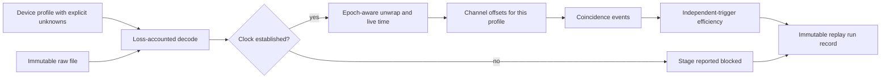

# Laboratory device profile and offline replay (M4/M5 software foundation)

Status, 2026-10-28: **implemented and numerically verified on synthetic fixtures
only**. No physical detector has been identified, no real DAQ sample exists and
no hardware was contacted. This is the software that the
[completion plan](completion-plan.md) M4/M5 work will plug real equipment into;
it is not a model of the user's detector.

## What exists

| Part | Module | Behaviour |
|---|---|---|
| Device profile | `heplab.lab.profile` | Each quantity is `unknown`, `reported`, `documented` or `measured`. Only documented/measured values with a source can drive computation; `require()` raises otherwise. `identified` status requires device type, serial, active dimensions and a channel map. Control requires identification, a named operator and approved limits. |
| Intake profile | [`manifests/lab/cms-muon-box-intake.json`](../../manifests/lab/cms-muon-box-intake.json) | The user's equipment: `unidentified`, enclosure height 1–1.5 m as *reported* (not the active area), everything else unknown, control not permitted. |
| Contract | [`contracts/lab-device-profile.schema.json`](../../contracts/lab-device-profile.schema.json) | JSON Schema; semantic rules live in the loader. The example is a synthetic two-channel fixture. |
| Decoding | `heplab.lab.daq` | Hashes the raw file before and after; counts records read, decoded, invalid kinds, unmapped channels, truncated bytes, overflow records, reported drops and clock resets. Every record is decoded or counted as a named loss. |
| Clock | `heplab.lab.daq.unwrap_clock` | Needs an established clock (tick, counter width). One rollover per counter decrease; the maximum unambiguous gap is reported. Clock resets start new epochs that never merge. |
| Live time | `heplab.lab.daq.live_time` | Span minus declared dead time per epoch. Unmatched dead markers make it an upper bound; overflow is flagged as data lost while live. |
| Channel timing | `heplab.lab.events.load_offsets` | Offsets must name the exact profile digest and a source run, and cover every mapped channel; a missing channel is not a zero offset. Without offsets output is marked uncalibrated. |
| Events | `heplab.lab.events.build_events` | Fixed-window coincidence from the first hit, per epoch, with a hit-conservation check. |
| Efficiency | `heplab.lab.events.trigger_efficiency` | Only against a trigger source declared `independent` in the profile; triggers in dead time are excluded and counted. Reported as trigger-denominated, not active-area efficiency (no external track positions yet). |
| Replay | `heplab.lab.replay` / `heplab lab replay` | Writes an immutable run record: raw hash, profile digest and unknown list, config hash, source-tree hash, stage outputs and blocked stages. |



## Usage

```bash
heplab lab profile manifests/lab/cms-muon-box-intake.json
```

```bash
heplab lab replay --profile PROFILE.json --raw RUN.bin --output artifacts/lab/run.json --trigger-source 1
```

Replaying with the intake profile runs decoding (every hit is counted as an
unmapped channel) and reports the clock stage as blocked. That is the intended
result until the equipment is identified.

## Limits and next steps

- `heplab-synthetic-daq-v1` is a test format (8-byte magic, then big-endian
  `kind:u8 channel:u8 counter:u32 payload:u16` records). A real decoder needs the
  equipment's decoding specification and golden files cut from a recorded sample.
- The run record accepts measured `conditions` programmatically; the CLI does not
  yet take temperature/pressure/mask inputs.
- Not implemented: amplitude/time-walk calibration, strip propagation, clustering,
  external track association and active-area selection, cosmic source (M6),
  any hardware control adapter.

Requirement evidence: [laboratory-replay-evidence.json](laboratory-replay-evidence.json);
tests in `tests/test_lab_replay.py`.
