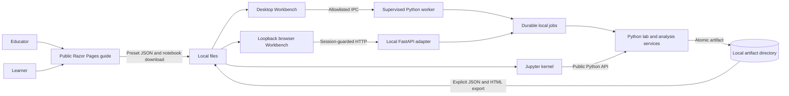

# HEPLab learning platform

## System design

HEPLab connects a guided lesson to an executable experiment and a reproducible
analysis. The public Razor Pages site owns publication and discovery. The
historical Tauri/WebView shell is not present in the current checkout. The
rebuild is a C++20/Qt 6 Workbench that will own local execution and inspection
through the surviving versioned Python JSON-lines worker. The loopback FastAPI
Workbench remains a compatibility and validation surface. Jupyter owns code
exploration and replay. The Python lab definition, dimuon analysis, fit, and
feedback checks provide the shared scientific behavior.

| Deployment | Process and storage boundaries |
| --- | --- |
| Installed desktop | The shell loads bundled UI assets and starts its worker through a validated IPC operation table. The worker owns the local job database and artifact directory. |
| Local browser and Jupyter | The browser talks to a loopback API. Jupyter runs in the student's HEPLab Python environment and receives a portable file selected by the student. |
| Public website | The site serves content, the preset, and the checked-in notebook. It does not need a Workbench session to deliver the lab. Its existing browser activity has its own sample and browser-local state. |
| Hosted classroom, proposed | Deploy identity and assignment/progress services separately from a bounded run queue and isolated execution workers. Artifacts belong to a learner or classroom. Any hosted Jupyter service needs its own user isolation, quotas, retention, and operator. |

Use Jupyter for the part of the coursework where students should read and
change the analysis. The notebook can regenerate the baseline, perturb one cut
while holding the rest fixed, and show the changed observable. The desktop
Workbench gives newcomers the same experiment through direct controls and makes
the event and cut response visible before they write code.

## Z-boson contracts and run lifecycle

- **Preset.** The website ships `heplab-lab-preset-v1` with `lab=z-boson` and
  `revision=1`. The preset identifies a bundled definition and cannot carry
  paths, executable code, dataset URLs or arbitrary run parameters. The
  validated request adds bounded pT, isolation and charge choices and optional
  answers. The canonical lab definition sets the 4,000-event practice sample,
  seed, fit window, default cuts and checkpoints.
- **Run.** Both transports submit to the same durable job engine. It supports
  queued, running, completed, failed and cancelled states, idempotency keys,
  bounded restart recovery and polling. The work checks for cancellation
  during the event loop and immediately before publication. A running numerical
  fit finishes before the worker acknowledges cancellation. The completed JSON
  is written atomically and can be recovered if the process stops between
  publication and updating the job state.
- **Result.** `heplab-z-boson-result-v1` includes the preset, generator and seed,
  event count and input digest, analysis configuration and version, cutflow,
  histogram with units, fit and library versions, and the existing
  `heplab-lab-progress-v1` checkpoint record. The download preserves the
  worker's JSON number representations so the content checksum survives
  transport through JavaScript. HTML is an independent offline view of the run.
- **Replay.** Jupyter verifies the artifact checksum and regenerates the
  declared sample locally. The cutflow and histogram must match exactly. The
  mean and error from a converged fit must match within 0.005 GeV. Jupyter can
  then vary the isolation cut without modifying the baseline artifact. The
  recorded input digest fingerprints that run's generated values; replay checks
  observable agreement to allow floating-point differences among runtimes.

The practice event display shows transverse momentum vectors from a common
interaction point. The sample is synthetic and the fit is a Gaussian plus a
uniform background. The quoted uncertainty is statistical. The Gaussian
width and the Z natural width describe different quantities. The separate
[Run 2 validation specification](run2-z-validation.md) governs comparisons with
recorded CMS data, official simulation and the pinned fast-simulation chain.

## Offline acceptance

1. Open `/education/` on the public guide and download the Workbench preset and
   notebook.
2. After Workbench and Jupyter setup, disconnect from external networks. In the
   desktop Workbench choose **Z-boson lab**, then **Open preset**.
   Inspect the dimuon event, try the mass and width questions, and run the
   analysis. Save both exports.
3. Put `heplab-z-boson-result.json` next to the downloaded notebook. Start a fresh
   HEPLab kernel and run all cells. Confirm the replay message and compare the
   changed cutflow and spectrum.

Use `pytest tests/test_z_boson_workflow.py` for the shared job and transport
regression coverage. Run `tools/check_site_runtime.py` against the Release and
published site. A release acceptance run also exercises actual desktop file
selection and export and executes the notebook from an isolated working
directory.

For an automated clean-kernel check, install `nbclient` and `ipykernel` in the
HEPLab environment and run
`python tools/check_z_boson_notebook.py z-boson.ipynb heplab-z-boson-result.json`.
The check permits loopback kernel messaging and rejects external Python sockets.

Windows acceptance on 2026-11-22 exercised the published downloads, preset
import and both exports in the Tauri Workbench, and replay of the actual
desktop JSON in a clean Jupyter kernel. The native test blocked external
WebView requests. The frozen Windows worker also passed a separate IPC run and
replay. With the default cuts the 4,000 synthetic events yielded 2,155 selected
pairs, all six checkpoints passed with the entered answers, and the fitted
peak was 91.153 ± 0.057 GeV (statistical). The notebook reproduced the saved
cutflow and histogram, then lowering relative isolation from 0.15 to 0.10
reduced the selected pairs to 2,150.

## Delivery sequence

| Increment | Exit criterion |
| --- | --- |
| Offline Z lab | The guide, desktop and clean Jupyter kernel exchange a reproducible result with synthetic scope visible at each step. |
| Curriculum and packaging | Add curvature and detector response labs using the same lesson pattern. Provide fresh-machine installation evidence, accessible alternatives, and repeatable notebook checks. |
| Recorded-data extensions | Publish separately labelled classroom exercises for vetted data and simulation. Freeze scientific checks and independent samples before any validation claim. |
| Classroom services | Introduce opt-in assignments and sharing after authorization, retention, isolation, and resource budgets have been demonstrated on the hosted deployment. |

Automate fixture regressions, notebook execution, schema checks, packaging and
documentation verification. Publication, learner sharing and scientific changes
retain explicit review.
