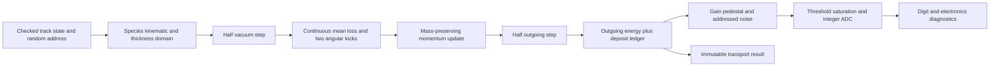

# Bounded material interactions and channel response

The Rust protocol now exposes `material` and `digitize` alongside vacuum propagation
and object-level response. The independent scalar Python reference implements the
same public operations. Neither backend claims a validated shower simulation.



## Thin slab contract

Input is a checked `TrackState` in metres, GeV, elementary-charge units, and
nanoseconds; a unique material-layer ID; path thickness in metres; radiation length
in metres; a declared constant stopping power in GeV/m; a beta-gamma validity
interval; a scattering flag; and a full addressed RNG identity. The slab thickness
is traversed path length, not a surface-normal thickness. There is no geometry
navigator in this operation.

Supported input: moving particles with mass at least 0.1 GeV and |charge|=1.
The input and outgoing beta-gamma must remain within the supplied stopping-power
domain. This is a user-declared table validity interval, not an automatic calibration
or a substitute for a species-dependent stopping table.

The deposit is `stopping_power * path_thickness`. Reject a loss exceeding 10% of
incident kinetic energy, invalid/nonfinite parameters, stopped or unsupported
particles, and steps leaving the stated validity range. The model does not silently
clamp a particle to rest. Large losses need a real tabulated stepping model.

Scattering uses the classic Highland Gaussian-core approximation:

```text
fraction = thickness / radiation_length
theta0 = 0.0136 GeV / (beta * p) * sqrt(fraction) * (1 + 0.038 * ln(fraction))
```

This implementation restricts `0.001 <= fraction <= 0.1` and `theta0 <= 0.2 rad`.
Two independent addressed normal draws perturb an orthonormal transverse basis;
the outgoing direction is normalized. The magnitude follows
`sqrt((E_after-m)*(E_after+m))`, retaining invariant mass. A midpoint convention
places loss/kick between two straight half steps. No axial field is applied inside
this slab operation; compose vacuum propagation explicitly outside it.

The reported energy residual is `E_before - E_after - deposit`. The medium absorbs
momentum exchange, whose recoil is not tracked. Non-Gaussian scattering tails,
straggling, delta rays, electron/photon interactions, bremsstrahlung, nuclear
interactions, secondaries, showers, and stopping/at-rest behavior remain unsupported.
Changing the subdivision can change this approximation: do not subdivide blindly
below its Highland thickness domain.

The physical reference is the [PDG passage-through-matter review](https://pdg.lbl.gov/2025/reviews/rpp2025-rev-passage-particles-matter.pdf),
particularly its distinction between heavy-particle loss, scattering, and radiative
processes. The constant stopping power and conservative domain guards are project
assumptions. The current GUI uses the held-out-tested [PDG mean-ionization fit](geometry-calibration.md)
for muons in silicon. Electronics and scattering remain separate approximate models.

## Electronics contract

The separate `digitize` operation consumes an already-accounted nonnegative deposit.
It computes `analog = deposit * gain + pedestal + sigma_noise * N(0,1)` with an
addressed channel-noise stream. The threshold comparison is inclusive. Below-threshold
channels produce `adc: null`; accepted channels floor the signal after limiting it
to `[0, saturation]`. Saturation is reported explicitly. Parameters must be finite,
gain positive, noise/pedestal/threshold nonnegative, and
`threshold < saturation <= 16777215 ADC`.

ADC is an electronics observable. Noise and pedestal do not alter the physical
deposit or material energy ledger. This model does not aggregate timed hits,
simulate shaping/pileup, quantize TDC, reconstruct clusters, or apply calibrated
channel gains. It must not be combined with a second complete detector response
over the same physical effect.

## Verification scope

Rust unit tests establish a known continuous loss, mass/energy conservation,
invalid-domain rejection, threshold endpoints, and saturation. Python regressions
independently check analytic limits and 2000 sampled projected scattering angles
and noise amplitudes. The compiled CLI and four-worker PyO3 binding are compared
with the scalar reference over 1007 requests, including 100 material and 100 digit
cases. These checks establish scoped numerical/software behavior; external transport
comparisons and detector calibration remain open.
