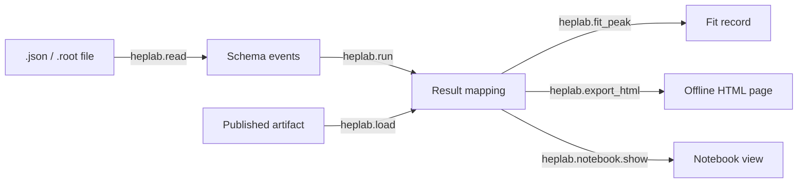

# Python API (v1)

The `heplab` package exposes a small API for analyses that already have
normalized HEPLab event records in memory. Source acquisition, certification,
artifact publication, and resumable jobs remain available through the CLI and
Workbench.

```python
import heplab

result = heplab.run(events, analysis="dimuon", config=analysis_config)
artifact = heplab.load("artifacts/dimuon-result.json")
```

`events` is an iterable of dictionaries following the current event schema.
`config` is the same analysis configuration accepted by `heplab run dimuon`.
The `run` function returns an in-memory analysis result; it does not fetch data
or write files. `load` reads a published JSON artifact and checks its canonical
payload and deterministic result digests when present. Older artifacts without
those digests remain readable.

`heplab.API_VERSION` is the independent Python API contract version. A breaking
change to public function signatures or the normalized event/result contract
requires a new API version. Package and artifact schema versions evolve
independently.

The current API supports only `analysis="dimuon"`. Other analysis plugins and
streaming input adapters are not part of this API yet.

## Functions



| Function | Purpose |
| --- | --- |
| `heplab.run(events, analysis="dimuon", config=None)` | Run an analysis over in-memory schema events; returns the result mapping. |
| `heplab.load(path)` | Read a published artifact and verify its digests. |
| `heplab.read(path, simulation=False, max_events=None, format="nanoaod")` | Read a local `.json` event list or `.root` file into schema events. Unflagged JSON events take the declared kind; a NanoAOD simulation file read as data is refused. |
| `heplab.fit_peak(result, window=(70, 110))` | Gaussian-plus-flat unbinned fit of a `run` result's candidate masses (needs `heplab[analysis]`). |
| `heplab.export_html(result_or_path, output, title=None)` | Write one self-contained, offline HTML page (see [sharing results](education-and-sharing.md)). |
| `heplab.notebook` | `show(result)` inline display and `LiveHistogram` for Jupyter. |
| `heplab.labs` | Guided labs with step checks (education mode). |

```python
import heplab

events = heplab.read("events.json", simulation=True)
result = heplab.run(events, config={"selection": {"muons": {"min_pt": 20}}})
fit = heplab.fit_peak(result)
heplab.export_html(result, "z-peak.html")
```

`heplab.notebook` and `heplab.labs` load on first attribute access, so
`import heplab` stays dependency-free.
