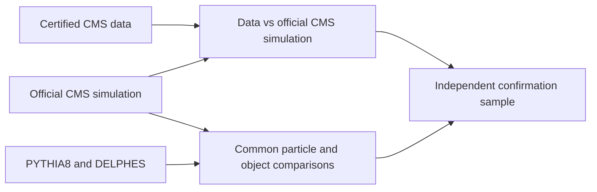

# Run 2 Z → μμ validation benchmark

Status: specification for review. Execution, detector corrections, and model tuning require a separate approval. Scope is 2016 proton–proton collisions at 13 TeV, using the dimuon Z region as the first benchmark.

## Samples and independence

| Role | Input | Purpose |
| --- | --- | --- |
| Recorded data | Certified CMS Run2016G NanoAOD, CERN record 30522 | Establish the measured reference and expose data-quality and selection effects. |
| Full-simulation control | CMS UL2016 Drell–Yan NanoAOD, CERN record 35671, MadGraph MLM + PYTHIA8 | Check the analysis against official simulation. Confirm the detector era, pileup and reconstruction campaign from metadata before combining samples. |
| Fast simulation | Pinned HEPLab PYTHIA8 → DELPHES chain at 13 TeV | Measure the difference between the fast chain and the control in an explicitly common population. Record generator tune, PDF, decay settings, card, seeds and generator phase space. |

Use the existing first-file Run2016G extract to develop the selection and outputs. Reserve a separate certified file or run period before inspecting results. Record file checksums, entry ranges, run and lumi coverage, event-ID overlap checks, software revisions, and the frozen selection and binning. If independence or coverage cannot be established, label the run exploratory.

## Frozen selection and comparisons

1. For the recorded-data control, use the existing 2016 certification mask, either configured DZ dimuon trigger, tight muon ID, relative isolation below 0.15, absolute η below 2.4, both muons above 15 GeV/c and the leading muon above 25 GeV/c. Choose the opposite-sign pair with the highest scalar pT sum before applying a 60 ≤ mμμ < 120 GeV/c² reconstructed-mass window. Freeze a stable tie-break on object indices and publish a cutflow. Confirm triggers, ID and isolation meanings in both NanoAOD populations.
2. For the fast-chain comparison, keep a separate common particle-level definition. Use prompt stable muons from the DY decay, dress them with prompt photons within ΔR < 0.1, and document any unavailable ancestry. At reconstructed level use a separately declared kinematic and isolation comparison. CMS trigger bits and tight muon ID have no direct DELPHES equivalent. Treat their effects as separate acceptance or efficiency terms.
3. Audit migration across the reconstructed mass edges. The current fast sample has a generator mass window of 60–120 GeV. A comparison that depends on migration from outside that window is blocked until a sufficiently wide sample or a quantified migration study is approved. No extra branching factor may be applied to a generator cross section that already includes the declared decay convention.

## Evidence and decision rules

- Publish unweighted event counts and weighted sums with sum of weights squared at every cut. Preserve signed weights. For shapes, provide the bin-normalization convention and statistical covariance. Quote yields only with justified certified luminosity, MC normalization, and declared corrections and backgrounds.
- Primary shape observables are mμμ (60–120 GeV/c², 2 GeV/c² bins), pair pT (0, 5, 10, 20, 30, 50, 80, 120, 200 GeV/c), and single-muon |η| (0, 0.9, 1.7, 2.4). Retain flow bins and show ratio and pull panels with a correlated uncertainty summary. Report data/control and fast/control independently.
- Fast/control differences combine generator and detector-response effects. In particular, the official control has matrix-element jet matching while the fast chain uses PYTHIA's hard process and shower. Use particle-level comparisons to identify generator differences. To isolate detector response, compare both responses against common generator inputs or report that attribution remains unresolved.
- Report the fitted Z location and width only with a documented signal, FSR and background model and fit-window stability checks. Study momentum scale and resolution by charge, pT and η if a discrepancy warrants a follow-up. Use an explicit tag-and-probe denominator and trigger matching for efficiency claims.
- Freeze numerical acceptance tolerances and minimum effective sample sizes in a separate signed-off benchmark manifest before unblinding the holdout. Derive them from the intended use, available statistics and known systematic uncertainties. Until then, results can be **exploratory** or **blocked**. Once frozen, publish **pass** or **fail** by observable, including discrepant bins and the provenance of any subsequent specification revision.
- The first deliverable is the evidence bundle, not a tune. It contains input manifests, selection and weights, cutflows, covariance or uncertainty breakdown, per-observable decisions, failed gates, and reproducible commands. A model change is a separate proposal motivated by these residuals.

Existing evidence includes a same-file CMS Z split and a separate low-mass regression whose Υ(2S) gate fails. Preserve both results and their scopes. [HEPLab CMS reference](cms-conditions-and-measurements.md) · [HEPLab physics assessment](../scientific-review/02_PHYSICS_VALIDATION.md)

[CMS Run2016G NanoAOD](https://opendata.cern.ch/record/30522) · [CMS UL2016 DY simulation](https://opendata.cern.ch/record/35671) · [CMS 13 TeV Drell–Yan measurement](https://cms-results.web.cern.ch/cms-results/public-results/publications/SMP-17-001/index.html) · [CMS Run 2 tracking tag-and-probe](https://cds.cern.ch/record/2724492/)
