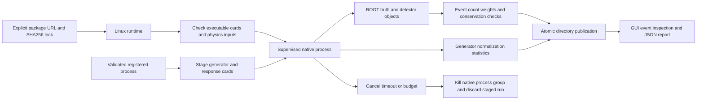

# PYTHIA8 / DELPHES runtime and acceptance

The working integration uses the official integrated `DelphesPythia8` driver.
It generates showered/hadronized events and immediately applies the DELPHES CMS
card. This path does not require an intermediate HepMC file. The older digest-only
container wrappers remain separate legacy interfaces; no project container is
published by this increment.



## Supported runtime

Pinned packages: PYTHIA 8.312, DELPHES 3.5.1, ROOT 6.40.04, HepMC3 3.3.1,
Python 3.12. The checked Linux-64 lock resolves 182 packages and requires
x86-64 microarchitecture level 3 (AVX2-class hardware). Native Windows and macOS
simulation binaries are not supplied. Windows uses WSL Ubuntu. Other CPU/OS targets
need separately resolved, tested locks; the Python reference bench remains portable.

Repository inputs: `deploy/sim/environment.yml` is a solver specification;
`deploy/sim/linux-64.explicit.lock` is the resolved URL/SHA256 lock;
`deploy/sim/runtime-inventory.json` records this installation's hashes. Binary
relocation can alter bytes, so a fresh installation generates its own inventory.
The worker verifies the local inventory before each production run.

From a Linux/WSL shell with micromamba installed, in the project root:

```sh
micromamba create -y -p "$HOME/.cache/heplab/sim-runtime" -f deploy/sim/linux-64.explicit.lock
CONDA_PREFIX="$HOME/.cache/heplab/sim-runtime" "$HOME/.cache/heplab/sim-runtime/bin/python" tools/freeze_sim_runtime.py
export HEPLAB_SIM_PREFIX="$HOME/.cache/heplab/sim-runtime"
heplab sim doctor
heplab sim chain --events 100 --seed 42 --output artifacts/my-first-collision-run
```

The freezer normalizes the package card location and records executable, card,
PYTHIA XML/PDF data, and primary simulation-library hashes. The complete lock
freezes dependency packages. A checksum inventory is not a cryptographic attestation
against a compromised local machine.

For this Windows workspace, launch the installed runtimes and GUI:

```powershell
.\tools\start_workbench.ps1
```

The script derives the WSL user and project paths. It configures the Rust executable
only when built, and the simulation prefix only when installed. The desktop app
and `heplab gui` also discover the conventional runtime automatically: the user's
home prefix on Linux, or a WSL installation on Windows (Ubuntu preferred; Docker
distributions excluded). Missing capabilities are displayed beside the run controls.
The frozen desktop worker includes numpy, awkward, uproot and the staged supervisor
source; a system Windows Python installation is not required.

For a nonstandard installation in PowerShell, set `HEPLAB_SIM_PREFIX` to the Linux
installation path and `HEPLAB_SIM_WSL_DISTRO` to its distribution, then restart the
desktop app or call `heplab sim chain`. Explicit settings override discovery.

## Registered process and reproducibility

The initial process is symmetric 13 TeV pp, `ffbar2gmZ`, a 60–120 GeV hard-mass
window, forced muon decay, Monash tune 14, and internal PDF set 13. The adapter
accepts 1–100000 events, seeds 1–900000000, and 1–14 TeV beam total energy.
The GUI limits collision runs to 1000 events. No pileup or NLO matching is claimed.
The explicit generator settings and DELPHES random seed are written per run.

Randomness is reproducible for the fixed runtime/configuration/serial shard.
Physical branch content, including reconstructed objects, repeats in the two
100-event acceptance runs. ROOT file byte hashes can differ because metadata and
timing fields change. Generator sharding independence is not established.

## Normalization and validation boundary

Each committed run contains `events.root`, generator and response cards, the
supervisor source, `generator.log`, `preview.json`, and `run.json`. The report
contains signed weight sums, squared weights, accepted/selected/trial counts,
generator-estimated cross section and error converted from mb to pb, and input
and output hashes. The reported cross section includes the registered mass/decay
restrictions; do not multiply the muon branching fraction a second time.

The upstream printed statistics limit cross-section precision. Its trial count is
generator-internal, not a count of Python calls to `next()`. An incomplete requested
event population fails rather than quietly publishing a smaller sample.

Stable generator final states, including invisible species and remnants, are checked
against the two incoming protons. Tolerance is `max(0.002 GeV, 2e-5 * beam total energy)`
per four-vector component to allow native ROOT float rounding. Detector visible
objects are not required to conserve the full incoming beam energy.

The 100-event fixed-seed check reports a maximum truth residual of approximately
0.000276 GeV and a generator estimate of 1341 ± 78.97 pb. This is smoke-test evidence,
not an independently validated prediction or publishable measurement.

```sh
python tools/verify_sim_integration.py --output artifacts/new-sim-verification
```

This command runs two native 100-event repeats, reads their physical truth and
detector content through the project reader, compares identities, and exercises
real cancellation and timeout without committing failed runs. Use a new destination;
completed runs are immutable. Production output/log budgets are 1 GiB/16 MiB.

## Upstream sources and licensing

The command structure follows the [official DELPHES PYTHIA8 workbook](https://delphes.github.io/workbook/pythia8/).
The package lock is sourced from conda-forge; upstream projects are
[PYTHIA](https://pythia.org/documentation/), [DELPHES](https://github.com/delphes/delphes),
and [ROOT](https://root.cern/). Their licenses and scientific citation requirements
apply to their binaries and cards. HEPLab's Apache-2.0 license covers HEPLab source,
not a replacement license for upstream GPL dependencies. This increment installs
packages locally; it does not redistribute an all-in-one binary image.
