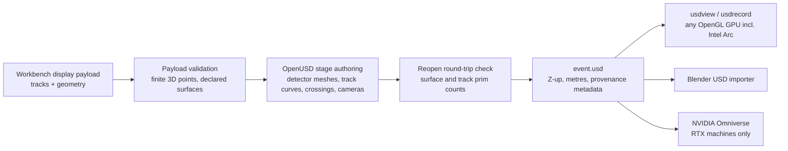

# USD event display export

Status: **implemented this increment** — round-trip tested; offline render
verified on an Intel Arc 140V integrated GPU through OpenUSD's Storm (OpenGL)
renderer. This is a *display interchange*, not a physics precision channel and
not a calibrated detector claim.

## Why USD, and what it buys without NVIDIA hardware

The interactive event display belongs to the local workbench (2D canvas,
[GUI design](gui-design.md)). The `heplab export-usd` command writes the same
display payload as an OpenUSD stage so it can be inspected and rendered by
tools outside HEPLab:

- **Authoring and inspection are CPU-only and vendor-neutral.** OpenUSD is
  Apache-2.0; writing a stage needs no GPU at all.
- **Viewing needs only OpenGL.** `usdview` and `usdrecord` from the prebuilt
  OpenUSD bundles render with the Storm Hydra delegate on any OpenGL GPU —
  including Intel integrated graphics (verified: Arc 140V, driver 32.0.101.8831).
- **The same file is RTX-ready.** On any NVIDIA RTX machine the identical stage
  opens in NVIDIA Omniverse for path-traced rendering; nothing in the export is
  Omniverse-specific and nothing in HEPLab requires Omniverse.

This mirrors the project's optional-backend pattern (`pip install 'heplab[usd]'`
is the only new dependency; `heplab export-usd` fails with instructions when it
is absent, like `plot` and `fit`).



## Exported stage

Input is any workbench display payload — a `heplab-workbench-result-v2` run
artifact, a stored per-event bench record (`<run>-events/<n>.json`), or a
pythia-mode run with its `muon_display` overlay. The payload must carry
`tracks` and `geometry`; the exporter refuses anything else and never invents
surfaces or points.

| Prim | Content |
|---|---|
| `/World/detector/<surface>` | One double-sided mesh per guide surface: open tube for `cylinder`, annulus at `z_m` for `disk`, colored and made translucent by subsystem |
| `/World/tracks/track_NNN` | One linear `BasisCurves` per track; sampled points copied verbatim; display color by charge (positive red, negative blue) |
| `/World/crossings` | One `UsdGeomPoints` with every predicted crossing; per-point `primvars:heplabSurfaceId` |
| `/World/main_camera`, `/World/tracker_camera` | Z-up look-at framings (modeled volume; tracker close-up) |

Layer metadata records the geometry id and sha256, event index, field model,
track count and the payload's own `display` note. Units are metres; up axis is
Z; float64 points are rounded to float32 on write — display fidelity, matching
the canvas renderer's contract, not a precision transport.

Every export is verified before returning: the file is reopened, and the
surface/track prim counts must match the payload.

## Commands

```sh
pip install -e '.[usd]'
heplab export-usd artifacts/workbench/<run>.json --output event.usd
```

Render headless without any NVIDIA hardware (prebuilt OpenUSD bundle with
bundled Python from NVIDIA's [USD developer page](https://developer.nvidia.com/usd);
`pip`'s `usd-core` wheel is authoring-only and has no imaging plugins):

```bat
C:\Users\<you>\.cache\heplab\scripts\usdrecord.bat ^
  --renderer Storm --imageWidth 1600 --camera /World/tracker_camera event.usd event.png
```

Interactive inspection: `scripts\usdview_gui.bat event.usd` from the same
bundle, or Blender's USD importer. Verified evidence for this increment:
`artifacts/usd-demo/event-tracker.png` and `event-overview.png`, rendered with
`HdStormRendererPlugin` on the Intel Arc 140V.

## Boundaries

- Crossings remain "5 mm sampled-polyline predictions; display only" — the
  stage carries `surface_id` labels, not sensor hits.
- The exporter validates and copies geometry from `heplab.physics.detector`;
  it never authors surfaces that the detector model does not declare.
- No Omniverse dependency, no runtime NVIDIA requirement, and no change to the
  workbench canvas path. A future Omniverse-based viewer would consume these
  stages unchanged.
