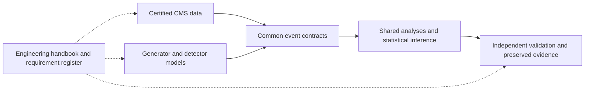

# HEPLab project documentation

Start with the [engineering handbook](engineering/README.md). It specifies the
entire target workflow, gives algorithms and diagrams for each subsystem, and
records what the prototype does and does not currently establish.

The new numerical/transport engine is specified in Rust, with Python interfaces
and established external C++ simulation models. The current executable
numerical reference covers Lorentz algebra, deterministic random streams,
uniform-field vacuum trajectories and weighted histograms. It is a scoped
reference with a compiled Rust numerical core and PyO3 binding. A calibrated
detector simulator remains implementation work. See the
[implementation increment](engineering/implementation.md) for scoped evidence.

Useful entry points:

- [Detailed implementation roadmap: physics, desktop, public website and GUI](engineering/implementation-roadmap.md)
- [System architecture and complete run logic](engineering/01-architecture.md)
- [Physics engine and numerical contracts](engineering/04-numerical-core.md)
- [Transport and material-model boundaries](engineering/06-transport.md)
- [Detector response and reconstruction](engineering/07-detector-response.md)
- [Verification and physics acceptance](engineering/14-verification.md)
- [Implementation inventory, 20 defects and delivery gates](engineering/17-delivery-plan.md)
- [68 traceable requirements](engineering/18-requirements.md)
- [Primary sources](engineering/19-sources.md)

Original sketches and ADR proposals are retained as history. Current release
claims require both implementation and recorded evidence; a diagram or a
passing structural validator cannot establish a correct physics model.
