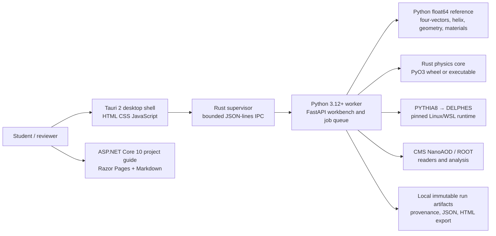

# 01 — Project Technical Overview

**Review date:** 30 October 2026 · **Repository:** HEPLab · **Scope:** the desktop
HEPLab Workbench and its associated public project guide, with the Python HEP analysis
and simulation code that supports them.

## Purpose and scope

The checkout is a broader high-energy physics software project, not a dedicated
quantum-mechanics simulator. Its desktop Workbench contains a muon-focused analytic
teaching bench, a separate PYTHIA8→DELPHES collision workflow, selected CMS Open Data
analysis paths, event displays and offline result export. In the analytic bench,
opposite-charge muons are declared as a test fixture; they are not generated as a
collision or as atmospheric cosmic rays. The phrase “Muon Particle Simulator” is
therefore suitable as a presentation label for the Workbench demonstration, but it
should not describe the full repository or imply full-detector muon transport.

The source and its own maturity flags support this conclusion: the public capability
report says “early implementation,” the numerical engine reports
`T0-analytic-thin-slab-and-educational-response`, and several output branches say
`educational_unvalidated` or `analytic_model_only`. A successful run means that the
software path ran, not that its detector physics is validated.

## Architecture

The desktop shell starts a packaged Python worker with an explicit executable and
argument vector; its Rust supervisor checks the worker handshake, protocol version,
operation set, request limits, cancellation and restart behavior. The same Python
Workbench job engine is used by the local browser workbench. Python implements the
inspectable reference calculations; selected operations are available through the
Rust core, built with Maturin/PyO3 or invoked as an executable. The native collision
path delegates generation and fast detector response to separately installed
PYTHIA8/DELPHES binaries. CMS ROOT data analysis is a parallel workflow, not evidence
that the analytic transport reproduces a CMS detector.

## Technologies found in the checkout

| Area | Technology actually present | Status and boundary |
|---|---|---|
| Analysis and application logic | Python, package metadata requires Python ≥3.12; review environment used 3.13.14 | Python reference, CLI, worker, readers, analyses, fit and export modules |
| Numerical core | Rust; PyO3/Maturin binding and standalone crate | Checked operations and Python/Rust parity paths; selected physics scope only |
| Desktop | Tauri 2, Rust shell, HTML/CSS/JavaScript | Packaged shell and worker protocol; no claim of a signed public installer |
| Public guide | ASP.NET Core Razor Pages targeting .NET 10, Markdig 1.5.1, plain JavaScript/CSS | Project guide and interactive educational pages; hosting/deployment state is not established by this audit |
| Analysis/science libraries | Optional NumPy, SciPy, Awkward, Uproot, PyArrow, Vector, Hist, Matplotlib/mplhep, iminuit; optional Coffea/Dask and zfit | Optional dependency groups; not all workflows require or install them |
| Native event workflow | PYTHIA8 and DELPHES through a staged local Linux/WSL runtime | Fixed DY→μμ setup, no pileup; current integration is not a general CMS simulation |
| Data and result formats | JSON, ROOT, Parquet, YAML manifests, offline HTML, optional OpenUSD | Source-range/provenance-aware workflows in selected paths |

See [root README](../../README.md), [package metadata](../../pyproject.toml),
[desktop shell configuration](../../desktop/src-tauri/tauri.conf.json),
[physics-engine guide](../../kernels/README.md) and
[web project file](../../web/HEPLab.Web/HEPLab.Web.csproj).

## Implemented capability status

| Capability | Classification | Evidence and limit |
|---|---|---|
| Relativistic four-vectors, invariant mass and passive boosts | Implemented; analytic identities independently checked | [reference.py](../../src/heplab/physics/reference.py#L39) |
| Uniform axial-field vacuum motion and time of flight | Implemented; closed form and invariants checked | [reference.py](../../src/heplab/physics/reference.py#L202) |
| Geometry guide surfaces and predicted crossings | Implemented; not sensor hits | [detector.py](../../src/heplab/physics/detector.py#L72) |
| CMS tracker OAE field and RK4 vacuum trajectory | Implemented; pinned software-reference regression, independent integrator grid and curvature/sagitta comparison exist; field measurements and run-era conditions remain unresolved | [cms_field.py](../../src/heplab/physics/cms_field.py#L24), [curvature.py](../../src/heplab/physics/curvature.py), [field evidence](../../src/heplab/data/reference/cms-field-validation.json), [sweep report](../../src/heplab/data/reference/curvature-sweep-v1.json) |
| Silicon mean stopping-power interpolation | Implemented; held-out agreement against a frozen PDG table | [calibration.py](../../src/heplab/physics/calibration.py#L24) |
| Highland-core scattering, single-slab energy update, channel digitization | Implemented; educational and unvalidated | [material.py](../../src/heplab/physics/material.py#L11) |
| Bernoulli efficiency and log-normal object response | Implemented; scoped transfer check against a pinned DY/DELPHES sample, with limitations | [calibration.py](../../src/heplab/physics/calibration.py#L127) |
| DY collision generation and fast detector response | Implemented in a pinned Linux/WSL chain; not full CMS transport | [pipeline.py](../../src/heplab/sim/pipeline.py#L132) |
| Muon proper-time survival | Implemented as a separate fixed-momentum vacuum experiment, not coupled to analytic trajectory transport | PDG lifetime, analytic exponential, seeded draws and bounded plane-parallel altitude-to-path conversion are checked. Atmospheric production, air material, showers, energy loss and daughters remain absent. [lifetime.py](../../src/heplab/physics/lifetime.py) |
| Quantum spin, weak decay amplitudes, entanglement or field-theory evolution | Absent | Current paths use classical relativistic kinematics, deterministic analytic transport and classical random sampling |

## Evidence basis and limits

The source tree includes targeted Python, Rust and integration tests for kinematics,
random streams, material arithmetic, trajectory parity, desktop protocol, data
analysis and exports. This implementation pass ran focused and full Python suites,
Rust checks and site builds; exact results are recorded in the implementation
checklist. The separate review script in
[`verification/independent_checks.py`](verification/independent_checks.py) was run
with the checked-out Python environment; its results and limitations are recorded in
[03 — Numerical Methods and Verification](03_NUMERICAL_VERIFICATION.md).

The worktree was already dirty before implementation and contains user-authored
desktop/site migration work. Those changes and untracked files were preserved. This
pass does not constitute a clean-commit release audit or establish production
deployment.

## Academic maturity

The defensible description is **an educational simulator with specific checked
submodels and an early-stage HEP data-analysis workflow**. Its four-vector,
ideal-field, named PDG mean-table, pinned CMSSW field-port and isolated lifetime
calculations have distinct bounded evidence. Its thin-slab response is a teaching
model. The low-mass CMS reference regression now uses target-independent candidate
selection and an event-disjoint holdout, but its frozen aggregate gate fails and the
holdout comes from one source file. HEPLab is not a globally validated CMS detector
simulator, a full atmospheric-muon simulator or research-grade transport code.

Continue with [physics validation](02_PHYSICS_VALIDATION.md),
[verification plan](03_NUMERICAL_VERIFICATION.md) and
[executive assessment](10_EXECUTIVE_ASSESSMENT.md).
