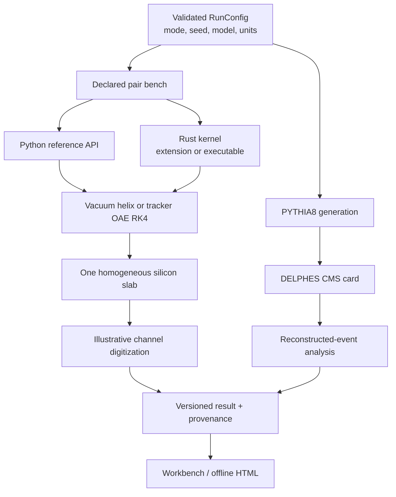

# 04 — Backend and Simulation Engine Improvements

## Current computation boundary

The Python physics reference and Rust core use strict request contracts and selected
parity checks. The Rust core has no `unsafe` code in the reviewed kernel path. The
desktop boundary uses bounded JSON-lines IPC; the job engine and artifacts are local.
This is a sensible foundation for an educational application. The largest technical
risk is the gap between an expanding set of CMS-branded models and the independent
validation required to interpret them.

## Implementation status after review

The P0 selection defect is corrected in the v2 reference regression. The candidate
selector chooses the opposite-charge pair with the largest scalar $p_T$ sum and has
no target-mass input; event hashing creates a frozen train/held-out split before the
fit. The held-out events come from the same Run2016G file, so they are not an
independent dataset. The aggregate reference gate **fails** at Υ(2S) under the
unchanged tolerance. The target-ranked v1 fixture remains preserved and ineligible
for validation claims.

Sourced PDG muon constants and a versioned fail-closed model registry now annotate
the reference bench. A fixed-momentum lifetime experiment is isolated from transport.
The independent verification registry covers exact uniform-field motion, a SciPy
DOP853 comparison for the pinned OAE field function, straight guide-surface roots,
PDG table-domain behavior, thin-slab energy bookkeeping, lifetime survival and
addressed RNG repeatability. A charge/momentum/field curvature sweep checks exact
uniform-field sagittae against a separate circle formula, then reports the bounded
OAE field's endpoint deltas from uniform 3.8 T without inventing a field-measurement
gate. The sweep is downloadable from the active site with source hashes. A
fixed-fixture wrapper-inclusive Python/Rust benchmark
is available; it is a microbenchmark and does not establish end-to-end performance.

Workbench configuration envelopes now group run, analytic, collision, display and
analysis settings. Full-run and event-view artifacts carry separate schemas and
parent-linked digests; the user interface displays typed selection identity,
component IDs, domains and evidence limits. The canonical ASP.NET site has corrected
source links, a route/content contract, static synthetic/reference/recorded examples,
and downloadable grouped setup/result plus curvature/sagitta evidence. The setup pane
collapses advanced field, material and electronics controls behind an explanation,
and reports the first invalid active parameter before Run. Recorded-data chart
captions expose population sizes, normalization, covariance errors and omitted
corrections.

Remaining work with external dependencies is recorded in
[`IMPLEMENTATION_CHECKLIST.md`](IMPLEMENTATION_CHECKLIST.md): a separate matched CMS
data/MC sample with corrections and systematics, a pinned Geant4 material-response
reference, run-era GlobalTag/IOV conditions transport, sensor-response evidence, and
human accessibility/usability studies.

## Prioritized findings and required evidence

The following table records the original issues and the evidence needed to consider
their remedies complete; the implementation status above and checklist below are the
current state.

| Priority | Current limitation and consequence | Concrete change | Effort / dependencies | Acceptance evidence |
|---|---|---|---|---|
| **P0** | The low-mass regression chooses the candidate closest to the target PDG mass, then reports agreement to that target. This can sculpt closure and invalidate a validation claim. | Freeze a mass-independent event/candidate selection; keep all accepted candidates or use an event-level combinatoric model. Split before fitting, hash the rule, and report on untouched data. | Small–medium; Python analysis/build tool and frozen sample | Old result clearly relabeled as exploratory; new training/held-out result generated; no target value enters selection code |
| **P1** | Physics state has implicit conventions and hard-coded muon constants; field, slab, response and source data carry different scopes. A single “validated” flag can overstate transferability. | Introduce versioned `ModelSpec` metadata: model ID/version, units, particle domain, validity intervals, source/data hashes, conditions, validation state and limitations. Attach it to every track/result. | Medium; versioned JSON schema, migration plan | Artifact round-trip preserves model/version/provenance; unknown IDs fail closed; UI displays scope |
| **P1** | CMS OAE path uses a fixed nominal field parametrization and stops at its validity boundary; guide geometry is not a material navigator. No era/run/IOV conditions are resolved. | Keep the current path as `tracker-field reference`. A full-CMS option, if pursued, must load a pinned CMSSW geometry, field and conditions context; resolve IOV by run, navigate actual material, and store the conditions tag. | Large; CMSSW, Geant4, conditions access and expert review | Deterministic fixture at each era/run, boundary/energy ledger, cross-check against independent CMSSW/Geant4 transport; no extrapolation outside domain |
| **P1** | Slab loss is deterministic mean loss; scattering is a Gaussian core and medium recoil is omitted. `energy_residual` therefore checks bookkeeping, not full interaction conservation. | Keep this explicitly labeled. If teaching single-sensor response, add a selectable loss distribution (Landau/Vavilov or validated Geant4 reference) with generated energy-transfer ledger and accepted material-specific domain. | Medium for reference tables; large for Geant4 transport | Distribution-level comparisons with fixed thickness/material/particle settings; mean, width, tail and convergence gates frozen before evaluation |
| **P1** | Muon proper-time decay is absent, so long flight-distance experiments cannot show actual decay survival. | Add an independent survival-mode operation first: $u\sim U(0,1)$, $s_{decay}=-\beta\gamma c\tau_\mu\ln u$, or evaluate the analytic survival curve. Keep the no-decay track path unchanged and expose lifetime scope separately. | Small; PDG lifetime and tests | Exponential survival agrees with binomial/analytic expectation over a grid of momentum and distance; fixed-seed replay; no daughter claims until decay kinematics is implemented |
| **P1** | Validation artifacts and code are scattered across JSON reports, docs and generated examples; an operator may confuse table regression, software parity, calibration and physics validation. | Create a machine-readable verification registry with named observables, source hashes, test command/version, threshold, observed value, scope, date, environment and `not_established` list; generate the UI table and docs from it. | Medium; schema and build step | Every displayed status has a source artifact and reproducible command; stale evidence is visibly stale |
| **P2** | There are Python and Rust implementations; broader parity and performance evidence are limited. More language/toolchain surface increases maintenance burden. | Keep Python as oracle and Rust for measured hot paths. Use independent fixed fixtures for semantics; benchmark end-to-end worker/IPC versus calculation before optimizing or adding another kernel language. | Small for fixtures; medium for benchmark suite | Clean benchmark report includes CPU, compiler, Python, workload, uncertainty and reference parity; no performance-only backend changes |
| **P2** | `RunConfig` combines analytic physics, response overlays and collision analysis settings. This raises invalid combinations and makes provenance harder to read. | Split configuration into discriminated schemas: `AnalyticBenchConfig`, `CollisionConfig`, `DisplayConfig` and `AnalysisConfig`, with a single immutable run envelope. | Medium; API migration and artifact versioning | Invalid combinations rejected before job start; old artifacts still load via explicit migration |
| **P2** | Export actions can blur whole-run and selected-event scope; raw per-object arrays may be large. | Define separate versioned `RunArtifact` and `EventView` exports with `run_id`, `event_index`, source/model IDs and parent digest. Preserve the immutable full artifact. | Small–medium; JSON schema + UI wording | Round-trip tests prove event export is scoped and parent-linked; run export includes complete provenance |
| **P3** | Full Geant4/CMSSW simulation is expensive to package and validate for a solo project. | Do not build a custom detector transport engine. First produce a small pinned example through established Geant4/CMS software; only expose it if reproducible on the target computer and its conditions and calibration can be explained. | Large; open-source runtime, disk/CPU, CMSSW expertise | Reproducible install/run instructions and independent closure before exposing a “full” mode |

The user-facing collision workflow already follows a suitable route for a **fast**
detector illustration: PYTHIA8 plus DELPHES. DELPHES is designed as fast generic
detector-response simulation, not detailed Geant4 transport [R9]. Geant4 or CMSSW
would only be justified by the need for detailed geometry, materials, conditions and
secondary transport, not by a desire for more code or speed [R8]. SciPy is useful as
an independent ODE/optimization reference; it need not become a runtime dependency of
the core.

## Implementation sequence and remaining decision

1. **Done; evidence gate failed.** Remove the PDG-target selection input, freeze an
   event-level split, and preserve the old target-ranked artifact as exploratory. The
   corrected same-file holdout still fails its Υ(2S) aggregate gate.
2. **Done for current result contracts.** Version model, units, domains, evidence and
   provenance without changing the supported physical models.
3. **Done as a separate experiment.** Add analytic and seeded muon survival without
   coupling decay to track transport or claiming daughters.
4. **Done for wrapper-inclusive microbenchmarks.** Keep Python/Rust semantic fixtures
   and record the measured scope; end-to-end worker/IPC performance is not established.
5. **Open product/science decision.** Retain the educational bench plus fast DELPHES
   mode, or pursue a separate conditions-aware CMSSW/Geant4 workflow. Keep the labels
   separate and never use the analytic field or geometry as a proxy for full transport.

## Engineering checks to preserve

- Validate exact request schemas, finite values, input budgets and model domains at
  API and native boundaries.
- Preserve canonical RNG addresses, version identifiers and fixed-seed fixtures.
- Store source/data hashes, seed, run config, software/runtime versions, field/model
  IDs, output schema and validation scope.
- Test cancellation, restart and output immutability separately from physics.
- Keep full-run and event exports separate and keep local paths out of shareable
  public artifacts unless the user explicitly requests them.
- Do not describe the energy residual of a single slab as total energy-momentum
  conservation of particle plus medium; recoil is not modeled.
