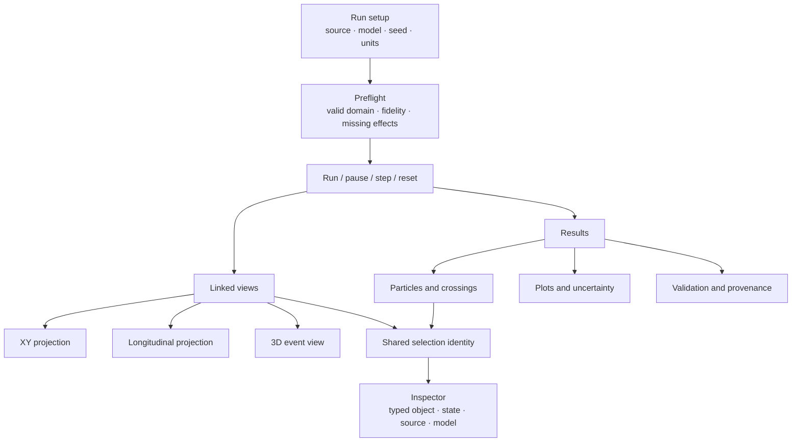

# 05 — Desktop UI/UX Improvement Plan

## Current workbench

The desktop is a Tauri WebView around a local workbench UI. The source includes a
model/data browser, experiment and run controls, a parameter inspector, particle
table, XY/XZ/3D canvas, detector-layer visibility/opacity controls, event navigation,
replay, run diagnostics, crossing table, capability checks and reference-validation
tab. It exposes units in control labels, run seed and selected backend, live preview,
Run/Stop controls, and a Canvas2D fallback when WebGL is unavailable. The canvas has
an accessible name and adjacent particle tables expose numeric values.

The UI has strong scientific communication choices: it distinguishes a declared
analytic pair from collision data, labels display crossings as predictions, and
states that CMS/DELPHES muon display tracks are IP-assumed ideal-solenoid
extrapolations rather than fitted tracks or hits. Preserve those labels. Source:
[workbench markup](../../src/heplab/server/static/index.html#L23),
[selection/inspector](../../src/heplab/server/static/workbench.js#L937) and
[Tauri window sizing](../../desktop/src-tauri/tauri.conf.json).

## Usability risks

1. **Three scientific tasks compete for attention.** Data selection, analysis,
   detector display, simulation parameters, calibration status and result browsing
   share one dense workspace. The default desktop window is 1440×900; its minimum
   width is now 800 px so the existing narrow single-column CSS can be reached.
   The Windows Tauri release executable and frozen worker now build in an isolated
   staging tree. The build does not verify installed-window reflow or behavior on
   high-DPI Windows devices.
2. **A canvas cannot carry the whole scientific record.** Hover/picking and replay
   are useful, but surface crossings, object state and provenance must remain in
   tables/inspectors. The canvas should not be the only way to find an object.
3. **Object kinds are not equally synchronized.** Muon selection links table, tree
   and canvas. Reconstructed-object row selection fills the inspector and row state,
   but the canvas renderer does not hit-test or highlight those non-muon objects.
   A user can therefore inspect an object that is not visibly emphasized.
4. **Model overlays can look like a unified detector result.** The optional reference
   response is sampled from the original truth state as a separate branch. It does
   not replace the path shown in the analytic trajectory. Make that relationship
   visible in the canvas legend and comparison table.
5. **Replay clock needs plain-language context.** The UI accelerates animation for
   readability. Mark the control “accelerated path replay”; physical `time_ns` is a
   model output and should not be read as wall-clock playback time.
6. **Narrow-window/assistive-technology evidence is incomplete.** The source contains
   semantic tabs, labels, `aria-live`, focusable canvas, keyboard navigation and
   reduced-motion CSS. No packaged screen-reader, focus-order, contrast, zoom/reflow
   or task-based user study was performed in this audit.

## Proposed scientific workspace

## Implementation status after review

The workbench now keeps a persistent object/evidence legend and labels crossings as
predictions. Muon selection is carried as a typed `(kind, event_id, object_id)` value
across tree, table, inspector, canvas and synchronized XY/XZ panels. Supported
reconstructed non-muon rows also carry typed selection identity into the inspector;
selecting one clears the previous muon highlight and explicitly says when it is not
displayed as a trajectory. The interface exposes linked transverse and longitudinal
views by default, switchable single XY/XZ and 3D views, a shared path cursor, model
IDs, units, derived track quantities, preflight scope, renderer/view status,
keyboard/table actions, zoom controls, and reduced-motion guidance.

Saved-run comparison, raw-count overlays, configuration/provenance summaries and
comparison JSON exports now exist. Histograms state their populations, units,
binning, denominators, event-clustered statistical errors and omitted systematics.
The analytic bench shows event-clustered count whiskers; weighted collision charts
use event-level sum-of-weights-squared errors. Response diagnostics plot binned
efficiency with Wilson intervals and matched relative-$p_T$ residuals, and summarize
matched-object bias/RMS explicitly as illustrative response diagnostics rather than
calibration. The lifetime experiment includes an analytic survival curve and a seeded
estimate with its Wilson interval. First-run
cards include curvature, separate survival, silicon mean loss/electronics, and the
bounded field comparison. Replay is labeled as accelerated path visualization,
not physical flight time.

The paired XY/XZ mode shows guide surfaces and muon paths; detailed CMS modules remain
available in the single-projection and 3D views. Formal text-scaling, packaged
screen-reader, contrast, task-based student/instructor usability, and accessibility
evaluation still need actual Windows devices and participants. Those human-evidence
items are not marked passed by source inspection or software tests.

The default parameter view now keeps source, seed, event budget, momentum and response
visible while truth-to-object response, field, slab and electronics settings are behind
an explained, keyboard-operable disclosure. The disclosure remains discoverable through the model tree. The
first invalid field for the active mode is announced as corrective text before Run;
this code behavior does not replace packaged keyboard and assistive-technology review.

## Recommendations and acceptance criteria

| Priority | Recommendation | Scientific or usability problem solved | Acceptance criterion |
|---|---|---|---|
| **P1** | Add a persistent preflight summary with model name/version, assumptions, valid ranges, omitted effects and validation status before the user presses Run. Repeat the summary in the saved result. | Prevents users from treating a successful run or CMS-looking geometry as a validated detector simulation. | For every RunConfig, the UI can show the same model metadata stored in the artifact; no unknown maturity state appears as “passed.” |
| **P1** | Use explicit object categories/legend styles: truth input, analytic trajectory, predicted crossing, DELPHES response object, measured NanoAOD object, and digitized channel. | Separates objects with different epistemic status and source. | Every plotted layer has text name, source and units; color is redundant with shape/line style; legend remains visible in exports. |
| **P1** | One typed selection identity (`kind`, `event_id`, `object_id`) drives tree, table, canvas and inspector. For objects that cannot be picked in the canvas, table selection must still clear stale highlights and state “not shown as a trajectory.” | Eliminates mismatch between table, inspector and visual focus. | Keyboard and pointer selection of every object type updates every supported panel; tests cover stale selection and event changes. |
| **P2** | Add synchronized XY and longitudinal views as a default pair; make 3D a switchable inspection view. Preserve shared path/time cursor and selected object. | Helps infer curvature and (z)-motion without perspective ambiguity; supports event-by-event review. | Choosing a path point in one view updates the other views and table row; axes and units are always shown. |
| **P2** | Organize setup as ordered sections: Source → Physics model → Numerical settings → Detector/response → Run. Put advanced response and field choices behind explanatory expandable sections. | Reduces configuration load and makes dependencies/invalid combinations easier to understand. | A first-time user can configure the default experiment without encountering unrelated CMS analysis settings; invalid parameters show corrective text before execution. |
| **P2** | Add a comparison pane for two saved runs: same event or parameter sweep, truth/reconstructed overlays, histogram ratio/residual and side-by-side configuration/provenance. | Enables controlled experiments and reveals whether changes affect results or only appearance. | Exported comparison includes both artifact hashes, seeds and an explicit model/selection difference summary. |
| **P2** | Add plot presets for histogram, efficiency, response bias/resolution and survival probability, with error bars and a definition of each denominator. | Makes statistical uncertainty and normalization part of the result rather than decorative chart styling. | Each plot states sample type, units, binning, statistical interval and unmodeled systematics. |
| **P2** | Keep all canvas actions available through table/keyboard controls; test at Windows text scaling, high zoom, keyboard-only and screen reader. Show “reduced renderer” when Canvas2D is active. | Supports accessibility and makes fallback capability visible. | Task-based checks complete with no canvas-only action; focus order and status announcements are verified on packaged builds. |
| **P3** | Add saved experiment templates: uniform-field curvature; μ lifetime clock; PDG silicon mean loss; field-map comparison. Each template includes assumptions and a cited expected result. | Gives a professor/student reproducible entry points tied to equations. | A template creates a versioned config and a result page that reproduces its expected analytic value within a declared tolerance. |

Established systems provide useful interaction patterns: ROOT TEve separates
event-scene selection, while ParaView supports linked views and selection links
[R14, R15]. Adopt their interaction concepts, not their installation or complexity.
Use WCAG 2.2 keyboard, focus, reflow and non-text contrast criteria as a web-content
baseline, then evaluate native desktop accessibility separately [R16].

## Suggested control specification

| Control | Display | Validation |
|---|---|---|
| Momentum and direction | `p` in GeV/c, `pT` derived, `eta` dimensionless, `phi` in rad | Show derived $\beta$, $\gamma$, $R$ before execution; warn if field/material model domain is exceeded |
| Field choice | “Ideal uniform 3.8 T bore” or “Pinned CMS tracker OAE, nominal 3.8 T, bounded” | Never shorten either option to “CMS field” without validity note |
| Material | “Single 1.0 mm silicon slab (illustrative)” with $X_0$, stopping-power reference and energy domain | Display mean loss separately from sampled scattering and signal; state no straggling/secondaries |
| Run status | queued/running/completed/cancelled/failed plus phase | `aria-live` text, log details and cancellation availability |
| Validation | “Software regression,” “PDG table agreement,” “unvalidated,” “calibration pending” | Each status links to evidence scope and source artifact |
| Export | “Export full run” and “Export selected event” | Show result hash, parent run and data/model source before saving |

