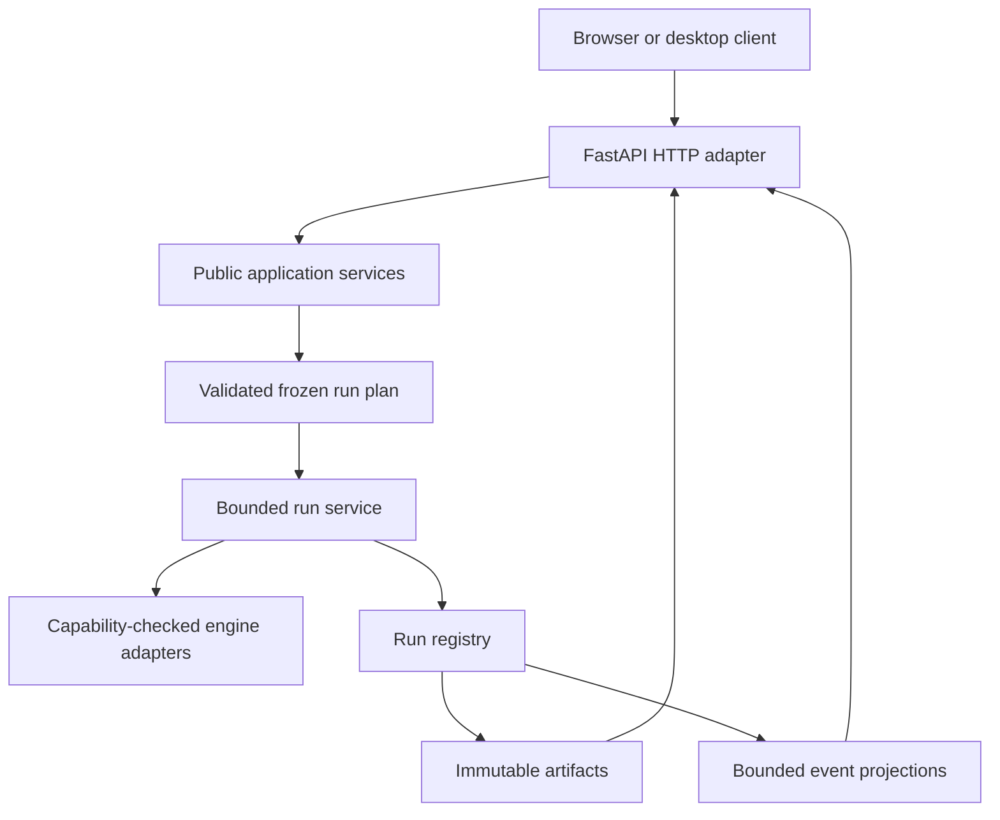

# Website backend and API integration

## Website boundary

The React project site reads `GET /api/v1/project/overview`, a public,
read-only summary of project name/version, license, capabilities, stack and
roadmap. It also reads `GET /api/v1/project/evidence`, a small excerpt from the
versioned silicon and CMS field reference records. Observable Plot renders the
held-out comparison using the reported points and preselected acceptance bounds.
The page has a static status fallback if the summary endpoint is unavailable.
The evidence endpoint exposes no user data, run operations, filesystem access,
secrets or simulator controls. Detailed claims link to repository documents as
the source of truth.

The website is not the simulator UI. It does not submit jobs, cancel jobs, read
events, or inspect local artifacts. `heplab gui --open-browser` opens the local
workbench at `/workbench`; the public overview is served at `/`.

## Simulator backend (separate application)

The separate local simulator execution stack is Python 3.12 with FastAPI, Pydantic and the
existing HEPLab services. Rust numerical kernels and registered native
PYTHIA8/DELPHES runtime are backend capabilities. The current app serves an
embedded simulator at `/` and `/ui/*`, a token-protected local job API, detector
and calibration descriptions, dataset/run inspection, and event access.

The React app must call public service contracts, never import source files or
reach into the artifact directory. The existing API is an incremental bridge;
it is not yet the complete target REST contract in
`docs/engineering/12-interfaces.md`.

## Target service boundaries

The adapter validates a request and delegates to application services. Services
own simulation and artifact semantics. Storage owns durable IDs and confinement.
The UI never chooses executable names or filesystem paths.

## API evolution

Maintain `/api/v1` as a stable, versioned boundary. Before a frontend package is
implemented, define/check schemas for capability, run submission, run status,
events, artifacts, and structured errors. Existing endpoints include
`GET /api/v1/session`, `GET /api/v1/detector`, `GET /api/v1/calibration`,
`POST /api/v1/jobs`, job status/cancel/event routes, datasets and runs.
Normalize the frontend around these actual routes before introducing new ones.

Target run operations and constraints are specified in
`docs/engineering/12-interfaces.md`: opaque registered IDs, idempotent submit,
bounded pages/payloads, cancellation, stable error codes, and validated
capabilities. Use a local token for mutations, kept in memory and sent in a
header. Do not put it in a URL or persistent browser storage.

## Development and production topology

- Development: start FastAPI locally; Vite proxies API requests to loopback.
- Local browser use: Python opens the browser on loopback after creating the
  service session; same-origin UI/API is preferred.
- Hosted project website: static pages only; no implicit connection to a local
  service and no proxying simulation requests to a public server.
- Desktop: future shell starts the local Python service and loads the packaged
  frontend; see [desktop packaging](04-desktop-packaging.md).

## Migration sequence

1. Record endpoint/request/response behavior and expose typed schemas.
2. Build frontend API adapter and run it against current service.
3. Move the shared service entry points out of any private CLI coupling.
4. Serve the compiled frontend from FastAPI for local and desktop modes.
5. Keep the embedded UI fallback until feature and security parity are accepted.
6. Version any incompatible contract; keep old clients functional through the
   supported migration window.

## Scientific result presentation

Every result view includes run ID, input/config hashes, seed, engine/runtime
versions, model domain, units, sample completeness, validation state and source
links. `SUCCEEDED` describes execution; it does not mean physics validation
passed. The interface must represent `unvalidated`, `validated` and `rejected`
separately and preserve immutable parent artifacts.
