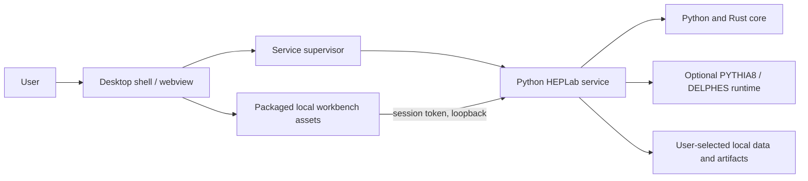

# Desktop packaging direction

## Goal

Package the same frontend and scientific services as an installable local
application without forking simulator behavior. The current application is a
local web workbench launched by Python; no standalone desktop package is
implemented yet.

## Proposed packaging model

Evaluate Tauri as the shell after the frontend/API boundary is stable. A shell
may host the static UI and supervise a bundled or provisioned Python service.
The Python environment includes scientific libraries and an optional, separately
installed native simulation runtime; this is materially larger and more
platform-sensitive than the web assets. Keep that runtime modular and report
missing capabilities clearly.

The diagram is a target, not a claim that Tauri, installer, update system or
Python bundling currently exists.

## Process lifecycle requirements

- Reserve an ephemeral loopback port and pass it privately to the shell.
- Wait for a health/capability handshake before showing the ready workspace.
- Create a random per-launch token and keep it out of command-line arguments,
  logs, URLs and persistent storage.
- Shut down gracefully on app exit; terminate owned child process trees on crash
  or timeout, and never kill unrelated user processes.
- Keep logs in the user data directory with rotation and secret redaction.
- Make artifact and cache locations visible/configurable and support backup.

## Platform and release gates

Start with Windows (using the documented WSL runtime where needed), Linux and
macOS as separate support targets. For each platform define Python/Rust support,
native runtime availability, signing/notarization, installer/update behavior,
upgrade/data migration, offline installation, and vulnerability response.
Do not promise native collision simulation on a platform without a resolved and
validated runtime lock.

Before a public desktop release, require clean-machine installation, signature
verification, launch/quit/cancel/recovery checks, retained artifact integrity,
offline reference-bench mode, optional-runtime diagnosis, SBOM/license notices,
and documented rollback. Prefer a thin shell; avoid reimplementing physics or
maintaining independent UI code paths.
