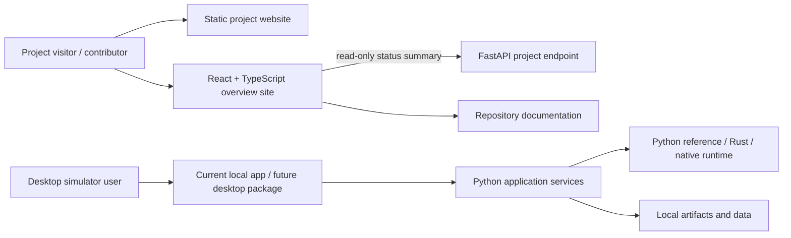

# HEPLab website and simulator application architecture

Status: the public project overview website is implemented in React/TypeScript
with a read-only FastAPI project summary endpoint. It explains implementation
status, evidence, roadmap, and documentation. Observable Plot renders the
source-backed held-out silicon comparison and reports the scope of a CMS field
reference regression. It does not run simulations. The simulator remains a
local Python application and a separate desktop app is planned, not yet
distributed.

The site uses separate overview, capabilities, architecture, documentation,
and known-limitations pages. Its simulator documentation includes a labeled
schematic of the current local workbench regions and distinguishes those
implemented interface areas from future desktop product ideas.

## Visual and accessibility conventions

The site uses Open Sans for headings and Source Sans Pro for interface and
reading text, matching the font pairing CERN recommends for its web content.
It adopts clear, evidence-led science communication and visible keyboard focus
while retaining HEPLab's own identity and simulator-oriented color system. It
does not use CERN's central toolbar or logo: CERN specifies those elements for
CERN-managed websites, and this repository's project site is independently
maintained. See [CERN typography guidance](https://design-guidelines.web.cern.ch/video-fonts),
[website requirements](https://design-guidelines.web.cern.ch/guidelines-cern-websites),
and [CERN brand and content guidance](https://design-guidelines.web.cern.ch/our-identity/cern-brand).

## Documents

| Document | Purpose |
|---|---|
| [Product and information architecture](01-product-and-information-architecture.md) | Audiences, goals, sitemap, page requirements and navigation |
| [Frontend architecture](02-frontend-architecture.md) | React/TypeScript structure, design system, rendering and accessibility |
| [Backend and API integration](03-backend-and-api.md) | Read-only project summary endpoint and site integration |
| [Desktop packaging](04-desktop-packaging.md) | Future desktop shell, process lifecycle, platforms and release gates |
| [Security and privacy](05-security-and-privacy.md) | Local service protections, data handling, browser threat model |
| [Delivery plan](06-delivery-plan.md) | Milestones, decisions, acceptance evidence and open questions |

## Architecture at a glance

## Repository boundary

`web/` is the public overview frontend. Its only backend dependency is a
read-only project status and evidence excerpt. `src/heplab/` remains the
simulator service and contains the current local workbench UI. Public website
visitors never control the simulator or access local artifact/data directories.
The MkDocs engineering handbook remains the source for detailed scientific
contracts. Website pages summarize it and link to canonical documents.
