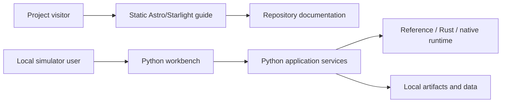

# Website and desktop architecture

The public project guide in `web/` is a static Astro site built with Starlight.
It explains HEPLab's current capabilities, local setup, evidence, limitations,
and contribution path. Markdown and MDX pages live under
`web/src/content/docs/`; the navigation and branding are configured in
`web/astro.config.mjs`.

The guide has no backend dependency and cannot run simulations or read local
artifacts. Deploy the generated `web/dist/` directory to a static host. The
simulator remains a separate local Python application; its current workbench
and service architecture are documented in the engineering handbook.

## Site commands

```powershell
pnpm --dir web install
pnpm --dir web dev
pnpm --dir web check
pnpm --dir web build
```

## Documents

| Document | Purpose |
|---|---|
| [Product and information architecture](01-product-and-information-architecture.md) | Audiences, goals, sitemap, and page requirements |
| [Frontend architecture](02-frontend-architecture.md) | Astro/Starlight structure and content flow |
| [Backend and API integration](03-backend-and-api.md) | Boundary between the static guide and local simulator service |
| [Desktop packaging](04-desktop-packaging.md) | Future desktop shell and release gates |
| [Security and privacy](05-security-and-privacy.md) | Local service protections and data handling |
| [Delivery plan](06-delivery-plan.md) | Milestones and acceptance evidence |

## Boundary



The engineering handbook remains authoritative for scientific contracts and
validation records. Public guide pages summarize that material and link to its
canonical source.
