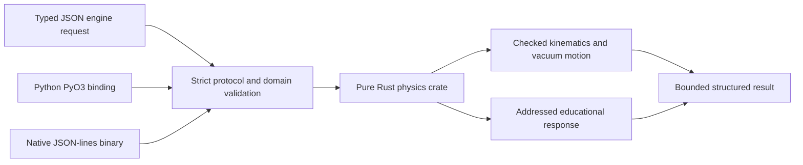

# HEPLab native physics engine

Current scope: checked Lorentz algebra, deterministic addressed randomness,
weighted histograms, analytic vacuum propagation in uniform Bz and an explicitly
educational positive-response model, bounded thin-slab material interactions, and
deposit-to-ADC electronics. Both the Rust CLI and PyO3 library were
compiled in Linux/WSL and compared against 1007 independent reference cases.
This engine has no calibrated detector/material/reconstruction claim.



The compiler is pinned by `rust-toolchain.toml`. Dependencies are pinned in the
two Cargo lockfiles. The pure crate has `forbid(unsafe_code)` and builds without
Python. The binding releases the GIL while executing Rust-only work.

From the repository root in a Rust-enabled Linux shell:

```sh
cargo test --locked --manifest-path kernels/physics-core/Cargo.toml
cargo clippy --locked --manifest-path kernels/physics-core/Cargo.toml --all-targets -- -D warnings
cargo build --locked --release --manifest-path kernels/physics-core/Cargo.toml
cargo build --locked --manifest-path kernels/Cargo.toml
python tools/verify_rust_engine.py --binary kernels/physics-core/target/release/heplab-physics --extension kernels/target/debug/libheplab_kernels.so
```

For a Python extension wheel, use `maturin build --manifest-path kernels/Cargo.toml
--release` on the target platform, then install the built wheel in that platform's
Python environment. A Linux `.so` cannot be imported directly into Windows Python.
Native Windows/macOS wheels remain a release gate.

The public Python API is `heplab.physics.engine.execute(request, backend='reference')`
or `backend='rust'`. Rust first uses the installed `heplab_kernels` module, then an
explicit `HEPLAB_RUST_EXECUTABLE`. No backend is silently substituted. CLI examples:

```text
heplab engine capabilities
heplab engine run examples/engine/mass.json
heplab engine run examples/engine/response.json --backend rust
```

For this Windows workspace, the verified WSL build can be selected in PowerShell:

```powershell
$env:HEPLAB_RUST_WSL_DISTRO = 'Ubuntu'
$env:HEPLAB_RUST_EXECUTABLE = '/mnt/d/CERN/kernels/physics-core/target/release/heplab-physics'
heplab engine run examples/engine/response.json --backend rust
```

RNG addressing includes stable event/object/stage IDs; Unicode labels use a
Python-compatible canonical JSON encoding. Histogram final edges go to overflow.
Transport units are metres, GeV, ns and tesla. Positive charge in positive Bz
initially along +x curves toward -y. See the
[numerical specification](../docs/engineering/04-numerical-core.md) and
[implementation evidence](../docs/engineering/implementation.md).
