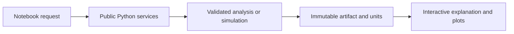

# Notebooks

> Gallery status: planned. See the [engineering interfaces](../docs/engineering/12-interfaces.md)
> and [delivery plan](../docs/engineering/17-delivery-plan.md). The names below are
> planned artifacts, not checked-in runnable notebooks.

One runnable notebook per analysis (primary interface, ADR-0009) plus
masterclass-guided versions. The gallery lands in Phase 2 with the dimuon
analysis; notebooks call the public Python API only — no private internals —
so they double as documentation and CI smoke tests.

Planned:

- `01_dimuon_spectrum.ipynb` — A1, stream a sample, fill the spectrum
- `02_z_measurement.ipynb` — A2, selection + fit
- `03_closure_dimuon.ipynb` — A3, sim-vs-data comparison
- `04_diphoton.ipynb` — A4, H→γγ bump hunt
- `masterclass/` — guided classroom versions
