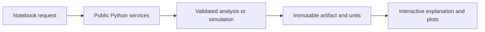

# Notebooks

## Training gallery

The gallery uses the public `heplab` API only. Synthetic notebooks are clearly
labelled; CMS and PYTHIA/DELPHES examples are capability-gated by checked-in
fixtures or runtime discovery.

| Notebook | Workflow | Data scope | Required extras |
|---|---|---|---|
| `gallery/01_environment_verification.ipynb` | Install, version and API verification | Synthetic/no data | core |
| `gallery/02_first_event_inspection.ipynb` | First schema event and invariant mass | Synthetic Z sample | core |
| `gallery/03_dimuon_spectrum.ipynb` | Cutflow, histogram and public API replay | Synthetic Z sample | `analysis` |
| `gallery/04_fit_and_reproducible_report.ipynb` | Fit, provenance and offline export | Synthetic Z artifact | `analysis` |
| `masterclass/z-boson.ipynb` | Guided Z-boson laboratory | Synthetic Z sample | `notebook`, `analysis` |

The gallery manifest is `gallery/gallery.json`. A notebook is not marked runnable
until it passes the repository notebook execution test.

> Runnable now: [`masterclass/z-boson.ipynb`](masterclass/z-boson.ipynb), the guided
> "Rediscover the Z boson" lab (works offline with the synthetic practice sample). The
> analysis notebooks listed under "Planned" are not checked in yet. See the
> [engineering interfaces](../docs/engineering/12-interfaces.md) and
> [delivery plan](../docs/engineering/17-delivery-plan.md).

To reproduce a Workbench run, use **Export for Jupyter**, put
`heplab-z-boson-result.json` next to the notebook, and run all cells in a fresh
HEPLab kernel. See the [learning platform design](../docs/engineering/learning-platform.md)
for the full handoff.

One runnable notebook per analysis (primary interface, ADR-0009) plus
masterclass-guided versions. The gallery lands in Phase 2 with the dimuon
analysis; notebooks call the public Python API only — no private internals —
so they double as documentation and CI smoke tests.

Planned:

- `01_dimuon_spectrum.ipynb` — A1, stream a sample, fill the spectrum
- `02_z_measurement.ipynb` — A2, selection + fit
- `03_closure_dimuon.ipynb` — A3, sim-vs-data comparison
- `04_diphoton.ipynb` — A4, H→γγ bump hunt
- `masterclass/` — guided classroom versions
