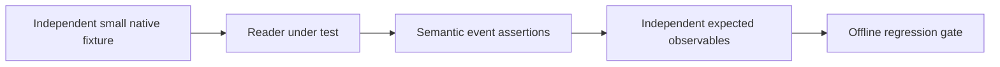

# Golden files

> Status: the native ROOT golden files listed below are planned and are not
> present. Independent numeric fixtures currently live in the physics reference
> tests. See [verification](../../docs/engineering/14-verification.md).

Tiny committed event samples that lock reader mappings (ADR-0003) and kernel
correctness (the ADR-0010 "oracle rule") without network access:

- `nanoaod_sample.root` — a few hundred events of Run 2 NanoAOD (Phase 1)
- `delphes_sample.root` — a small DELPHES output (Phase 3)
- expected schema-v1 parquet/JSON for each (the oracle)

Size budget: keep the directory under ~10 MB total; CI must stay fast and
offline. Everything in here is committed intentionally — the .gitignore
exception (`!tests/golden/*.root`) exists for exactly these files.
