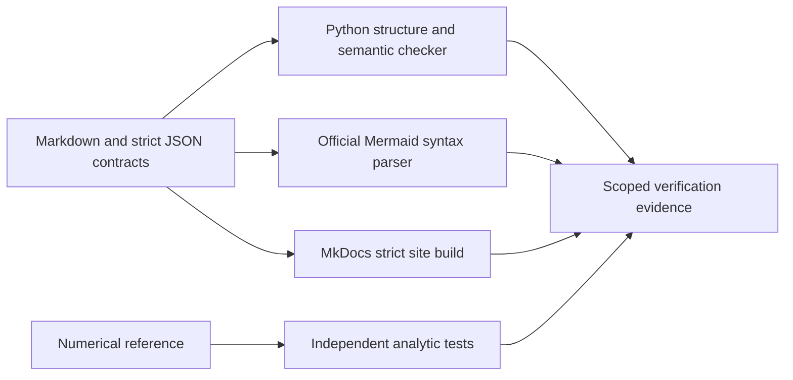

# Documentation and numerical verification tools



Install Python dependencies with `pip install -e '.[dev,docs]'`. From the project
root, run:

```text
python tools/check_handbook.py
python -m pytest tests/test_physics_reference.py -q
python -m mkdocs build --strict --site-dir .cache/handbook-site
```

For the official Mermaid syntax parser, install the pinned tool-only packages
into the ignored cache (Node.js required), then parse every Mermaid block:

```text
npm install --prefix .cache/handbook-tools --ignore-scripts --no-audit --no-fund mermaid@12.2.0 jsdom@26.1.0
node tools/check_mermaid.mjs
```

After building the HTML site, `python tools/export_handbook.py` writes a ZIP in
`artifacts/` containing the source handbook, contracts, numerical reference,
verification tools and HTML. It includes a file checksum inventory and excludes
event caches and installed packages. It is a design/reference export, not a
compiled detector-simulation release.

The HTML site build verifies navigation/links and generates a searchable local
site. The Mermaid parser verifies syntax; it does not prove a diagram matches
the code or assess its visual layout. Numeric tests cover the small reference
module and do not validate material models or a full detector. See
[the handbook](../docs/engineering/README.md) for implementation scope.

CMS source acquisition and verification: `import_cms_display.py`, `fetch_cms_field.py`,
`fetch_cms_measurements.py`, `validate_cms_measurements.py`, and
`verify_cms_models.py`. See [scope, gates and reproduction](../docs/engineering/cms-conditions-and-measurements.md).
