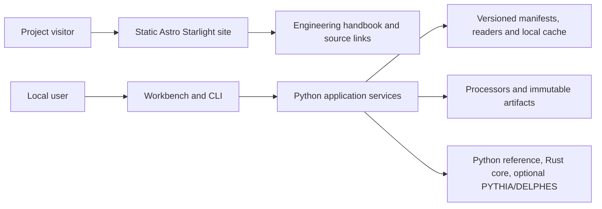

The public site is a static Astro Starlight documentation build. It does not call the local simulator API or read run artifacts. The simulator and data workflows run through the local Python application.

## Public site

Starlight renders Markdown documentation to static HTML. The documentation collection lives in `web/src/content/docs/`. Its built-in Pagefind search indexes that content at build time. There is no client-side framework, hosted compute, login, upload route, or project API dependency in the site.

## Local application

The Python service owns request validation, dataset access, job lifecycle, analysis, and artifact storage. The Rust core supplies selected numerical operations through its CLI and Python binding. PYTHIA8 and DELPHES are optional external runtimes with a pinned Linux/WSL installation.

The desktop shell packages a separate workbench frontend and supervises a local worker. It does not embed this Starlight site. See the [desktop packaging notes](https://github.com/adian007/HEPLab/blob/main/docs/web/04-desktop-packaging.md).

## Canonical contracts

The [engineering handbook](https://github.com/adian007/HEPLab/tree/main/docs/engineering), JSON schemas, dataset manifests, and recorded reference payloads are authoritative. This site summarizes them and links to the source; it does not define an alternate physics contract.
